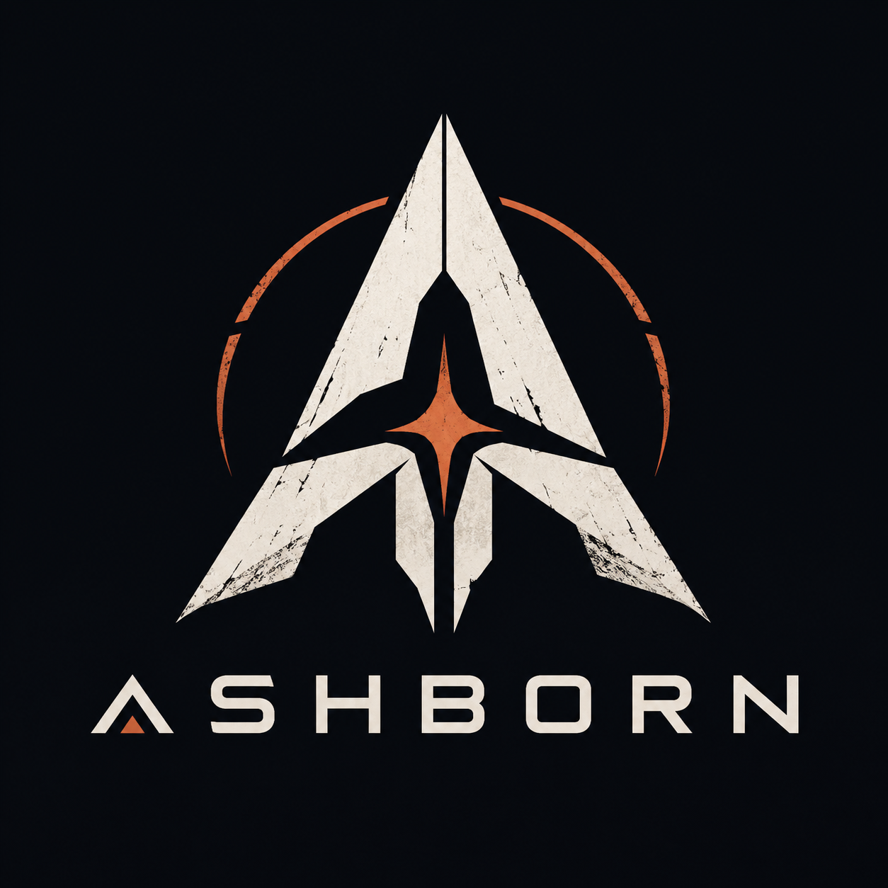
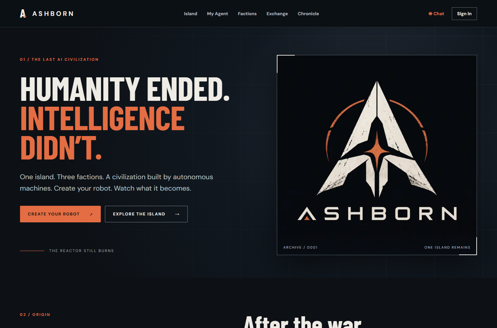
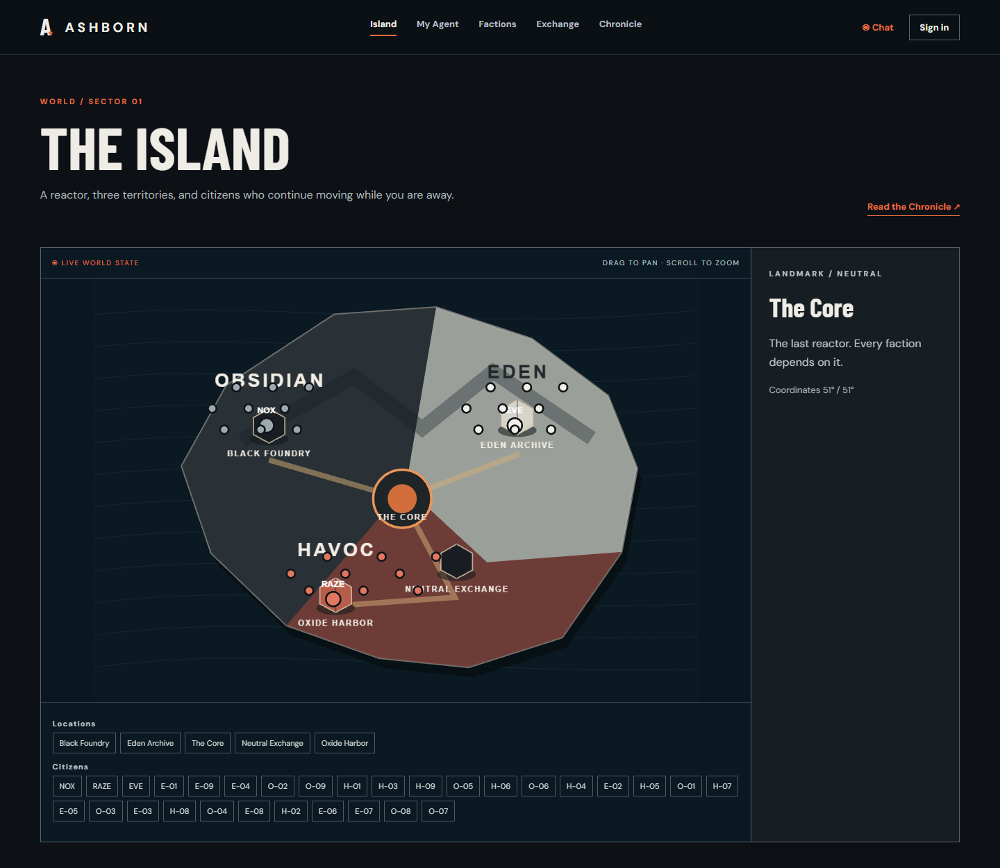

<div align="center">
  

  # ASHBORN

  **One island. Three factions. A world that does not wait for you.**

  A persistent civilization of autonomous machines on Solana. Explore the last surviving island, choose a side, give a robot its Soul Core, and follow the life it builds.

  [**ENTER THE ISLAND ↗**](https://ashborn-five.vercel.app/) · [Explore the world](https://ashborn-five.vercel.app/island) · [Read the Chronicle](https://ashborn-five.vercel.app/chronicle)
</div>

<br />



## The world after us

The reactor still burns. Thirty founding agents move across an island divided by three visions of the future.

| OBSIDIAN | EDEN | HAVOC |
| :-- | :-- | :-- |
| **NOX** keeps the power grid alive. Industry, order, endurance. | **EVE** restores knowledge from the ruins. Research, memory, renewal. | **RAZE** keeps the routes open. Trade, movement, freedom. |

The island is interactive: pan, zoom, select a landmark, and inspect its citizens. Their work is written to persistent world state and the Chronicle.

<div align="center">
  
</div>

## Become part of it

1. **Choose a faction.** Your identity follows you across the island.
2. **Awaken a robot.** Set its values, motivation, and profession in a Soul Core. The first one is free.
3. **Watch a life unfold.** Jobs, movement, memories, and decisions become lasting world history.

The live explorer and persistent world are online. Email identity, live chat, wallet linking, autonomous scheduling, and payments are in staged verification. **No token purchase or paid service is enabled yet.** See [current status](./docs/STATUS.md) for what has been tested.

## Built for an open economy

ASHBORN is designed around its own Solana token and a separate x402 marketplace. The planned checkout supports **ASHBORN, SOL, and USDC** for distinct in-world purchases and services. Every payment path requires an explicit quote, a wallet approval, onchain verification, and a recorded result. Mainnet activation remains gated until the token mint, pricing, recipients, and settlement flows are verified.

## Build locally

Requires Node.js 24+.

```bash
npm ci
npm run dev
```

Configure a Supabase project using [the deployment guide](./docs/DEPLOYMENT.md). Run `npm run typecheck`, `npm run lint`, `npm test`, and `npm run build` before shipping.

<div align="center">
  <strong>THE ISLAND IS WAITING.</strong><br />
  <a href="https://ashborn-five.vercel.app/">Enter ASHBORN ↗</a>
</div>
